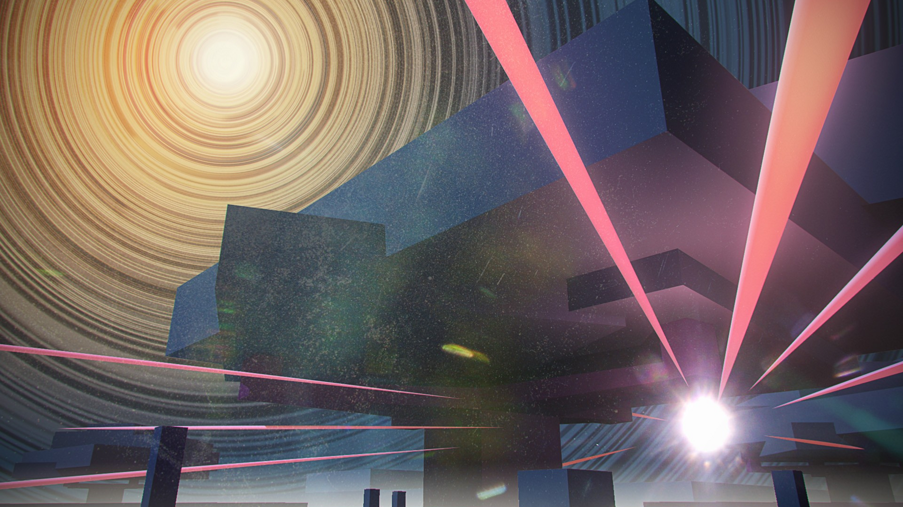

# ALTAIR

Named after **Altair IV** (*Forbidden Planet*, 1956): ancient alien
megastructures, colossal monoliths, orbital rings, warm dusty light, rose
beams, and cold silver-blue haze — paired with a mid-century starship
operator console.



## Install

```bash
omarchy theme install https://github.com/signaldirective/altair.git
```

or, for a local copy:

```bash
omarchy theme set altair
```

## Notes

- **Accent**: GNOME accent is `pink`, with `Yaru-blue` folder icons for a
  touch of cold steel-blue.
- **Unlock screen**: `unlock.png` is a mid-century COMPUTRON 2000 expedition
  operator console, with CRT, analog gauges, and function keys. Rebuild with
  `tools/generate-unlock.sh`.
- **Backgrounds**: six cinematic alien-landscape wallpapers in `backgrounds/`
  (monoliths, ring city, orbital megastructure, desert plaza, pyramid); cycle
  them with `omarchy theme bg next`.
- **Login / boot art**: run `omarchy gdm set-by-theme altair` and
  `omarchy plymouth set-by-theme altair` (both need sudo) to carry the
  console onto GDM and Plymouth.
- **Palette**: `colors.toml` — charcoal, slate, silver-blue, champagne beige,
  dusty rose, and a restrained phosphor green.
- **Omabuntu**: Compatible with both Omarchy and Omabuntu (hence the gnome-related stuff)
